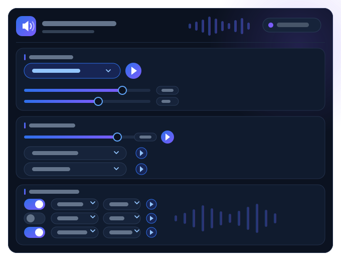

- **Generative background music that follows the stream** — notes are driven by the characters the agent actually paints, so the music rises and falls with the turn and stops when the turn does, instead of looping on a timer.
- **Different chimes for finishing and for waiting** — a completed turn plays a short completion chime; a session blocked on an approval or a question plays its own waiting chime, so you can look away and still know which one happened.
- **Per-phase sound settings** — thinking, answer text and tool execution each get their own switch, rate (characters per beat, or a pulse interval for tools) and pitch, stored under separate keys; the tool pulse can jitter like a typewriter, and every option has an audition button.
- **Everything stays in the browser** — settings are saved to `localStorage` under `dsh:coding-sound:v1`, so they survive a refresh or a restart, and each browser keeps its own set.
- **No audio assets, no network** — every note and chime is synthesized live with Web Audio in the page; the package ships no sound files and makes no runtime requests.
