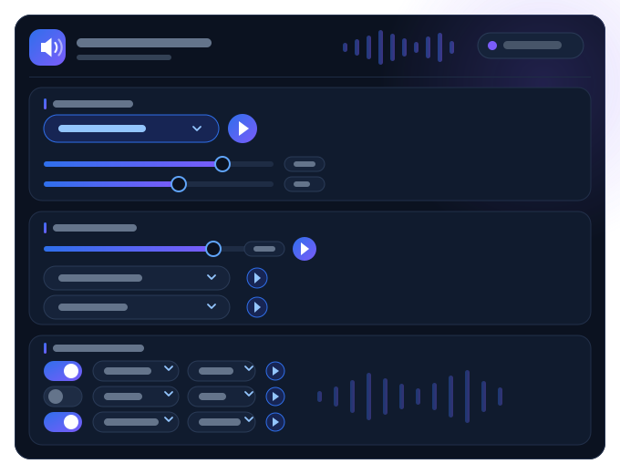

- **跟着流式输出走的生成式背景音乐**——音符由模型正在输出的文字驱动，快慢随这一轮工作起伏，停下来就停，而不是按定时器循环。
- **完成与等待是两种提示音**——一轮结束响「生成完成」；会话卡在审批或提问上时响独立的「等待操作」，切到别的窗口也不会漏掉。
- **按阶段调声音**——思考、回答正文、工具执行各有独立的开关、密度（每几字一拍，工具是脉冲间隔）和音高，键位分开；工具脉冲可以像打字机一样随机浮动，每个选项都能试听。
- **设置留在浏览器里**——保存在 `localStorage`（键 `dsh:coding-sound:v1`），刷新或重启后仍在，换一个浏览器是另一套。
- **没有音频素材、不联网**——所有音符与提示音都由页面里的 Web Audio 实时合成，包内没有声音文件，运行时也不发网络请求。
